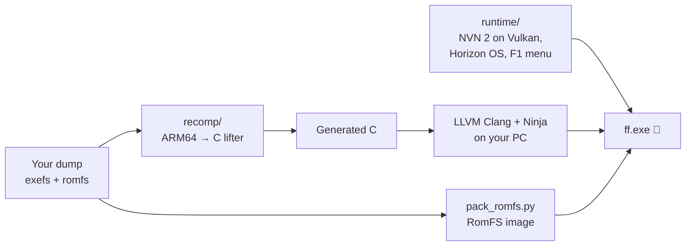

<div align="center">


# 🏁 FF-SlowSeparation

### Fast Fusion, running natively on Windows PC

*A static recompilation of the Nintendo Switch 2 game, not an emulator.*

[](#-requirements)
[](#-under-the-hood)
[](#-quick-start)
[](https://github.com/STS78721/SlowSeparation/releases)
[](#-credits--licence)

**[Quick start](#-quick-start)** · **[Features](#-highlights)** · **[Status](#-status)** · **[How it works](#-under-the-hood)** · **[Changelog](CHANGELOG.md)** · **[Credits](#-credits--licence)**

</div>

---

> [!IMPORTANT]
> **No game files are included.** You need your own legally dumped copy of **Fast Fusion (1.0.0)**: `exefs` and `romfs`. This repository contains only the recompiler, the runtime, the launcher, and the setup tools.

> [!NOTE]
> **Current release: `Alpha 0.1.0a`**, the first SteelTemple SlowSeparation build. It starts on a balanced baseline (`1920x1080` windowed, Original internal resolution, AMD FSR, Frame Generation Off, 60 FPS) so every system boots smoothly. Raise the internal resolution up to native 4K anytime in `FFLauncher` or in-game (`F1`). This is an alpha: expect rough edges outside the tested races.

## ✨ Highlights

<table>
<tr>
<td width="50%" valign="top">

### 🚀 Native code, not emulation
Every ARM64 instruction of `rtld`, `main`, `subsdk0`, `subsdk1`, and `sdk` is translated **ahead of time** into C and compiled natively on your PC into `ff.exe`. No CPU interpreter runs while you race.

### 🔭 True 1:1 resolution, up to 4K
On console the race renders at half size and is upscaled. SlowSeparation renders it **1:1** at **Original**, **720p**, **900p**, **1080p**, **1440p** (2560x1440), or **2160p** (native 4K), with the dynamic resolution shrink turned off, plus AMD FSR 1.0 and anisotropic filtering up to 16x.

### 🌤️ The sky stays blue
The full-resolution path used to lose the skybox to a black void. A texture-cache fix makes the depth copy the sky reads land in the right image, so clouds and sky render at every resolution.

</td>
<td width="50%" valign="top">

### 🎮 Switch-2-style settings menu
Press **F1** or **Esc** (or **Back + Y** on a controller) for the native settings overlay in the **SteelTemple SlowSeparation** theme: midnight indigo, hot-magenta and cyan neon, speed streaks and an anti-grav racer emblem (plus Light and Dark themes). Settings save to `ff.ini`.

### 🖥️ Setup Wizard & FFLauncher
Install with **SteelTemple FF-SlowSeparation Setup** (`Full-Setup-Wizard.exe`) or the portable archive. The bundled LLVM-MinGW, Ninja, and Python build `ff.exe` locally from your own dump, no external tools required. FFLauncher checks GitHub Releases and installs updates in place.

### 🕹️ Controllers & saves that stay yours
Works out of the box with Xbox, DualSense, Switch / Switch 2 Pro controllers, and keyboard. Includes mod folder shortcuts and timestamped save backup snapshots inside `FFLauncher`.

</td>
</tr>
</table>

## 📊 Status

| Area | State |
|---|---|
| Boot, menus, vehicle select | ✅ Working |
| Races (tested: first track, full HUD, AI field) | ✅ Playable at 1080p and native 4K, 1:1 |
| Sky, clouds, lighting, reflections at 1:1 | ✅ Fixed in Alpha 0.1.0a |
| Internal resolution (`original` – `2160p`) | ✅ Working |
| Audio & controller input | ✅ Working |
| Other tracks, cups, handheld mode | ⚠️ Not yet verified |
| Online play | ❌ Not supported, by design |

## 🚀 Quick start

**1. Install FF-SlowSeparation**

Download the latest **`Alpha 0.1.0a`** release from the **[Releases page](https://github.com/STS78721/SlowSeparation/releases)**:
- Run **`SteelTemple-FF-SlowSeparation-Alpha-0.1.0a-Full-Setup-Wizard.exe`** (no administrator rights needed), or extract **`Portable-StandAlone.zip`**.

**2. Set up from your Fast Fusion 1.0.0 dump**

Open **FFLauncher** → **SETUP FROM DUMP**, then pick one of:
- your `exefs` and `romfs` folders (ExeFS: `main`, `main.npdm`, `rtld`, `sdk`, `subsdk0`, `subsdk1`),
- a dump / NUP-extracted folder (flat ExeFS+RomFS, or `updates\<ver>\exefs` with an optional base), or
- a `.nup` container (**.NUP…**).

Click **VERIFY & BUILD FF.EXE**. It runs five steps: checks the SHA-256 hashes against Fast Fusion **1.0.0**, packs RomFS, lifts ARM64 to C, builds `ff.exe`, and **pre-warms every shader** (below). A hash mismatch means the dump is not 1.0.0 or the path points at the wrong folder; another version is never accepted silently.

> [!TIP]
> **Shader pre-warm (step 5/5).** Like MKW-THWOMP's warm step, setup readies the shaders before your first race: [`tools/prepare_shaders.py`](tools/prepare_shaders.py) lists every shader in your dump's ExeFS and RomFS and runs `ff.exe --prepare-shaders`, which translates each one into the shader cache and builds its pipeline libraries once, so the GPU driver's own cache is warm too. FFLauncher repeats it after an update that changes the translator.

**3. Race**: click **PLAY FAST FUSION** (or run `ff.exe`).

<details>
<summary>Building from source (developers)</summary>

```bat
python tools\check_content.py
python recomp\gen.py --exefs "<dump>\exefs" --out generated\ff100 --patches recomp\patches-ff100.txt --modules main,subsdk0,subsdk1,sdk
python tools\pack_romfs.py --dir "<dump>\romfs" --out build\extracted\ff100\romfs
python tools\build_game.py --version ff100 --gen generated\ff100 --exefs "<dump>\exefs" --romfs build\extracted\ff100\romfs
python tools\make_ff_icons.py
python tools\build_ff_release.py
```

</details>

## 🖥️ Requirements

| | Minimum | Recommended |
|---|---|---|
| OS | Windows 10 64-bit | Windows 11 |
| CPU | x86-64 with AVX2 | 8 cores or more |
| GPU | Vulkan 1.3, 6 GB VRAM | NVIDIA RTX 30/40/50 or AMD RX 6000/7000, 8+ GB VRAM (12+ GB for 4K) |
| RAM | 16 GB | 32 GB |
| Disk | ~15 GB free during setup | NVMe SSD |

## ⚙️ Settings

Press **F1** / **Esc** in game, or configure before launch in **FFLauncher**. Settings save to `ff.ini` next to `ff.exe` (template: [`ff.ini.example`](ff.ini.example)), and any option can also be overridden with `NS2_` / `TOTK_` environment variables.

| Setting | Values | Notes |
|---|---|---|
| `[graphics] resolution` | `original` · `720` · `900` · `1080` · `1440` · `2160` | Internal frame size, rendered 1:1. Restart to apply. |
| `[graphics] aniso` | `game` · `2` · `4` · `8` · `16` | Minimum anisotropic filtering on track surfaces. |
| `[display] res_hook` | `1` · `0` | The Fast Fusion resolution hooks; `0` keeps the console's half-size race render. |
| `[language] menu_theme` | `fusion` · `light` · `dark` | F1 menu theme. |

## 🔧 Under the hood



- **CPU:** Fast Fusion's ARM64 modules are lifted statically to C ([`recomp/`](recomp/)); [`runtime/`](runtime/) supplies the Horizon OS kernel, memory management, audio, input, and the settings UI.
- **GPU:** Switch 2 NVN 2 commands translate onto **Vulkan 1.3** with Graphics Pipeline Libraries, Ampere (`SM86`) shader lowering, AMD FSR 1.0, and frame-generation pacing.
- **Resolution:** [`runtime/resolution.c`](runtime/resolution.c) wraps the game's canvas setters, camera frame-buffer scale, render-target builders, and DLSS setup so the race renders at the chosen size, 1:1.
- **Icons:** the SlowSeparation icons are original art drawn by [`tools/make_ff_icons.py`](tools/make_ff_icons.py); no game artwork is used.
- **Release versioning:** [`VERSION`](VERSION) drives the version label across the Setup Wizard, `FFLauncher`, Windows Installed Apps, and the F1 menu (`Alpha 0.1.0a`), alongside [`CHANGELOG.md`](CHANGELOG.md).

## 🙏 Credits & licence

Part of the SteelTemple recomp family with **[MTF-ShadowRacket](https://github.com/STS78721/MTF-ShadowRacket)** and **[MKW-THWOMP](https://github.com/STS78721/MKW-THWOMP)**. Built on **Universal NS2 to PC**, **TotK Recomp**, **Eglantine** (Ampere SM86 shader lowering), **Ryujinx**, **MacNativeGames**, **SDL3**, **Dear ImGui**, **Vulkan Memory Allocator (VMA)**, **libopus**, **libvpx**, **dav1d**, **zstd**, and **FidelityFX FSR**.

Licensed under the **GNU GPL v3 or later** (see [`LICENSE`](LICENSE)); permissive and third-party notices are preserved in [`THIRD_PARTY_NOTICES.md`](THIRD_PARTY_NOTICES.md).

---

<div align="center">

<sub>Fast Fusion is a trademark of its respective owners (Shin'en Multimedia). Nintendo Switch 2 is a trademark of Nintendo. This is an unofficial non-commercial fan research project, not affiliated with or endorsed by either. Please support the official release.</sub>

</div>
